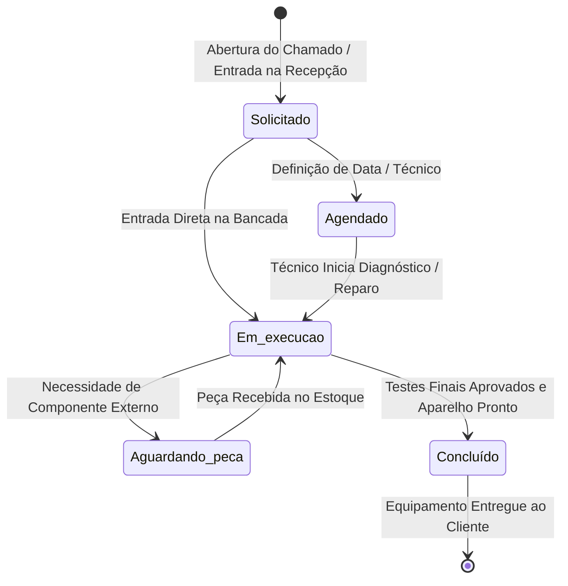
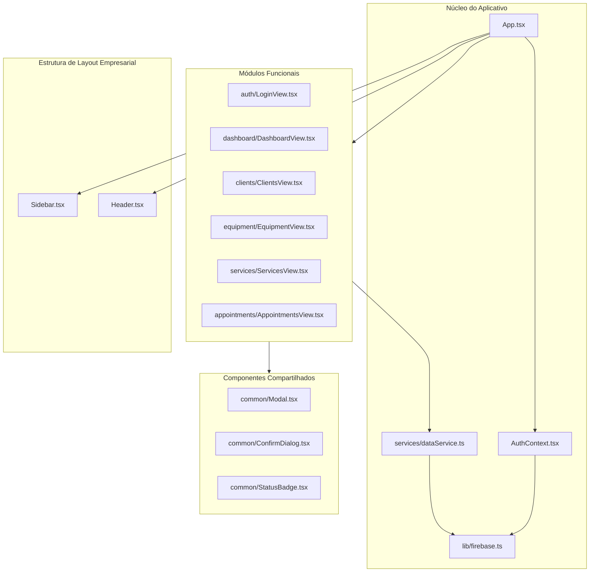

# DIAGRAMAS E ARQUITETURA TÉCNICA — OPTISERVICE (SIMPLITECH)
## Artefato de Software para o Relatório Periódico 2 (RP2)

---

### 1. Diagrama de Transição de Estados da Ordem de Serviço

Representa o ciclo de vida operacional na assistência técnica Simplitech:

---

### 2. Diagrama de Componentes do Frontend React

---

### 3. Dicionário de Dados do Cloud Firestore

#### Coleção: `clients`
| Campo | Tipo | Obrigatório | Descrição |
| :--- | :--- | :--- | :--- |
| `id` | String | Sim (Automático) | Identificador único do documento |
| `name` | String | Sim | Razão social ou nome do cliente |
| `document` | String | Não | CPF ou CNPJ |
| `phone` | String | Sim | Telefone principal de contato |
| `email` | String | Não | E-mail para notificações e orçamentos |
| `address` | String | Não | Endereço do cliente |
| `notes` | String | Não | Observações gerais |
| `createdAt` | ISO Timestamp | Sim | Data e hora de criação |
| `updatedAt` | ISO Timestamp | Sim | Data e hora da última modificação |

#### Coleção: `equipment`
| Campo | Tipo | Obrigatório | Descrição |
| :--- | :--- | :--- | :--- |
| `id` | String | Sim (Automático) | Identificador único do aparelho |
| `clientId` | String | Sim | ID do cliente proprietário (FK lógica) |
| `clientName` | String | Sim | Nome do cliente para consulta rápida |
| `type` | String | Sim | Categoria (Notebook, Desktop, Smartphone, etc.) |
| `brand` | String | Sim | Fabricante do equipamento |
| `model` | String | Sim | Modelo específico |
| `serialNumber` | String | Não | Número de série / Service Tag / IMEI |
| `conditionNotes`| String | Não | Avarias estéticas ou acessórios entregues |
| `createdAt` | ISO Timestamp | Sim | Registro de entrada |
| `updatedAt` | ISO Timestamp | Sim | Atualização cadastral |

#### Coleção: `services` (Ordens de Serviço)
| Campo | Tipo | Obrigatório | Descrição |
| :--- | :--- | :--- | :--- |
| `id` | String | Sim (Automático) | Identificador do documento |
| `serviceCode` | String | Sim | Código amigável (Ex: OS-2026-001) |
| `clientId` | String | Sim | ID do cliente solicitante |
| `clientName` | String | Sim | Nome do cliente |
| `equipmentId` | String | Sim | ID do aparelho |
| `equipmentSummary` | String | Sim | Resumo do aparelho (Tipo, Marca e Modelo) |
| `status` | Enum | Sim | `Solicitado`, `Agendado`, `Em execução`, `Aguardando peça`, `Concluído` |
| `priority` | Enum | Sim | `Baixa`, `Média`, `Alta`, `Urgente` |
| `reportedIssue` | String | Sim | Descrição do problema pelo cliente |
| `technicalDiagnosis` | String | Não | Parecer do técnico após análise |
| `solution` | String | Não | Procedimento técnico executado |
| `laborCost` | Number | Sim | Valor cobrado de mão de obra (R$) |
| `partsCost` | Number | Sim | Valor das peças substituídas (R$) |
| `totalCost` | Number | Sim | Soma de mão de obra + peças |
| `technicianName` | String | Não | Nome do técnico designado |
| `scheduledDate` | String | Não | Data prevista para término |
| `createdAt` | ISO Timestamp | Sim | Abertura do chamado |
| `updatedAt` | ISO Timestamp | Sim | Última movimentação |

#### Coleção: `appointments`
| Campo | Tipo | Obrigatório | Descrição |
| :--- | :--- | :--- | :--- |
| `id` | String | Sim (Automático) | Identificador do agendamento |
| `clientId` | String | Sim | ID do cliente agendado |
| `clientName` | String | Sim | Nome do cliente |
| `equipmentId` | String | Não | Aparelho associado |
| `scheduledDate`| String | Sim | Data agendada (AAAA-MM-DD) |
| `scheduledTime`| String | Sim | Horário agendado (HH:MM) |
| `status` | Enum | Sim | `Agendado`, `Confirmado`, `Realizado`, `Cancelado` |
| `notes` | String | Não | Instruções para a visita ou retirada |
