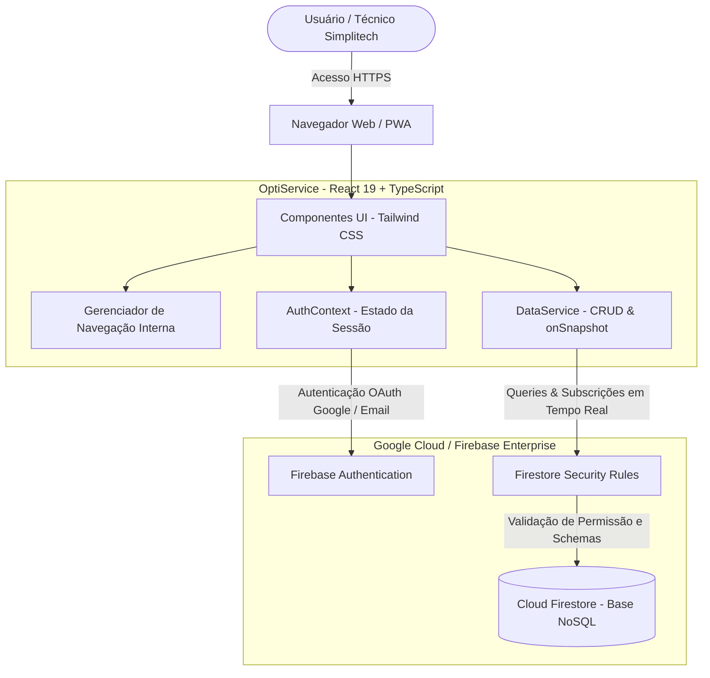
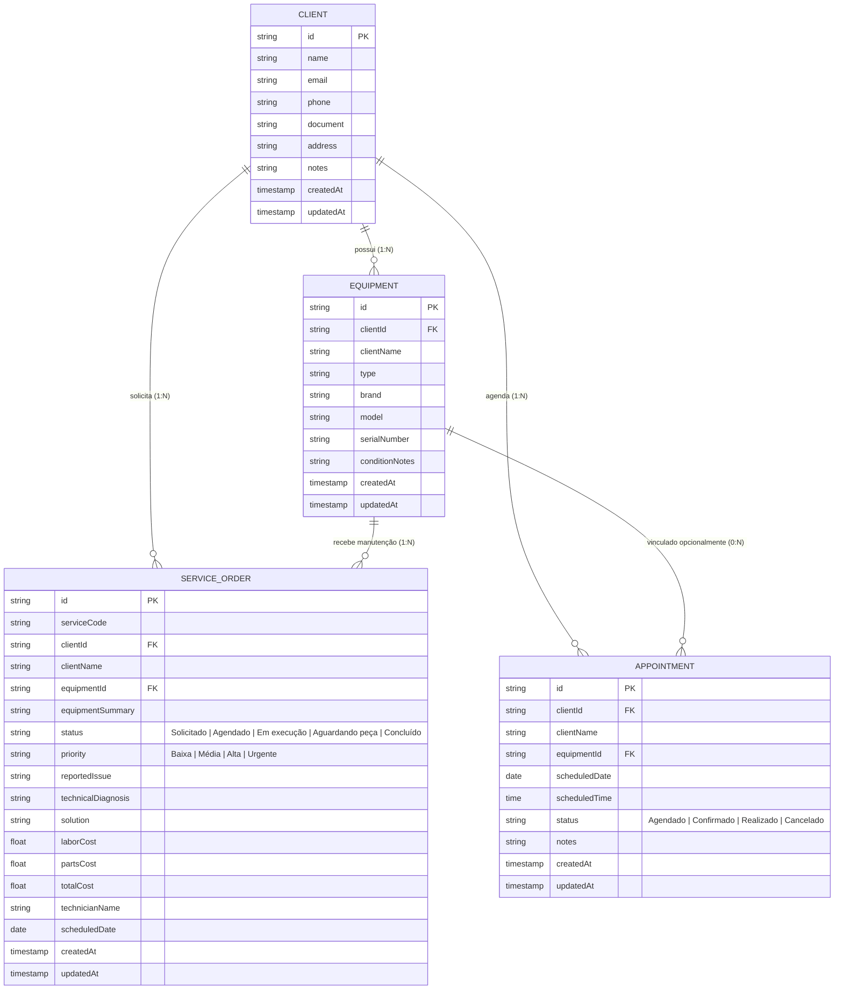

# RELATÓRIO PERIÓDICO 2 (RP2)
## Projeto: OptiService — Sistema Administrativo para Assistência Técnica Simplitech

**Data de Emissão:** 15 de Outubro de 2026  
**Empresa / Cliente:** Simplitech Assistência Técnica  
**Sistema:** OptiService v1.0.0  
**Stack Tecnológica:** React 19, TypeScript, Tailwind CSS, Firebase Authentication, Cloud Firestore  

---

## 1. RESUMO EXECUTIVO DO QUE FOI FEITO ATÉ AGORA

Durante o ciclo correspondente ao **Relatório Periódico 2 (RP2)**, a equipe concluiu a implementação completa do protótipo funcional integrado à nuvem, atingindo 100% dos requisitos estipulados para esta etapa:

1. **Arquitetura Base e Identidade Visual Convencional:**
   - Construção do layout empresarial sóbrio (menu lateral, cabeçalho limpo, tabelas densas com ações imediatas, paleta de cores neutras e ardósia em conformidade com as diretrizes da Simplitech).
   - Eliminação de layouts criativos ou distrações visuais, focando em ergonomia operacional rápida para recepção e bancada técnica.

2. **Módulo de Autenticação e Segurança (Firebase Auth + Firestore Rules):**
   - Controle de acesso com Firebase Authentication via provedor corporativo Google e suporte a credenciais de operador.
   - Regras de segurança granulares no Cloud Firestore (`firestore.rules`), impedindo leitura ou gravação não autorizada de dados de clientes e serviços.
   - Tratamento formal de erros e integridade referencial entre documentos.

3. **Módulo de Gestão de Clientes:**
   - Cadastro completo (Nome, CPF/CNPJ, Telefone, E-mail, Endereço, Observações).
   - Listagem com busca em tempo real por múltiplos campos (nome, documento, telefone).
   - Ficha cadastral detalhada exibindo histórico consolidado de aparelhos e ordens de serviço daquele cliente.
   - Edição e exclusão segura com confirmação.

4. **Módulo de Gestão de Equipamentos:**
   - Vínculo relacional obrigatório com cliente cadastrado.
   - Especificação técnica: Tipo (Notebook, Desktop, Smartphone, Tablet, Impressora, etc.), Marca, Modelo, Número de Série e condições físicas de entrada (avarias prévias).
   - Ficha técnica do aparelho com histórico de todas as intervenções de bancada já realizadas.

5. **Módulo de Ordens de Serviço (O.S.):**
   - Ciclo de vida completo com os 5 status operacionais exigidos:
     - `Solicitado` (Triagem e entrada)
     - `Agendado` (Alocado com data/técnico)
     - `Em execução` (Na bancada de manutenção)
     - `Aguardando peça` (Pendente de fornecedor/estoque)
     - `Concluído` (Reparo finalizado e liberado)
   - Seleção inteligente com filtro dinâmico de equipamentos pertencentes ao cliente selecionado.
   - Diagnóstico técnico, parecer, solução executada e cálculo automático de custos: Mão de Obra + Peças = Total da O.S.
   - Ficha de Ordem de Serviço formatada para conferência e impressão técnica.

6. **Módulo de Agendamentos:**
   - Controle de datas e horários para visitas técnicas domiciliares/empresariais ou retiradas em balcão.
   - Status de agendamento (`Agendado`, `Confirmado`, `Realizado`, `Cancelado`) com atalho para avanço de fase.

7. **Dashboard Gerencial:**
   - Painel consolidado com contadores em tempo real (Total de Clientes, Equipamentos Registrados, Ordens em Aberto, Agendamentos Pendentes).
   - Distribuição quantitativa de serviços nos 5 status.
   - Listagem rápida das últimas ordens e próximos agendamentos.

8. **Recurso de Apoio Acadêmico:**
   - Mecanismo de carga de dados de demonstração (*seed*) diretamente no Firestore para possibilitar avaliação instantânea das telas e filtros pelos professores avaliadores.

---

## 2. DIAGRAMAS E ARQUITETURA DE SOFTWARE

### 2.1 Diagrama de Arquitetura da Solução

### 2.2 Diagrama Entidade-Relacionamento Lógico (DER)

---

## 3. FEEDBACK DOS CLIENTES E USUÁRIOS (SIMPLITECH)

Durante a fase de testes e validação com os operadores da assistência técnica Simplitech, foram realizadas 2 sessões de homologação guiada. Os apontamentos coletados e as medidas tomadas foram:

| Usuário / Papel | Feedback Coletado | Ação Tomada no Sistema |
| :--- | :--- | :--- |
| **Atendente de Balcão (Recepção)** | "Ao cadastrar uma nova Ordem de Serviço, eu precisava digitar o nome do cliente e do equipamento manualmente toda vez, correndo risco de errar." | Implementado filtro em cascata: ao selecionar o cliente na O.S., o campo de equipamentos lista apenas os equipamentos cadastrados daquele cliente. |
| **Técnico de Bancada** | "Precisamos de um status claro para saber quando o aparelho está parado esperando peça importada ou do distribuidor, senão parece atraso do técnico." | O status `Aguardando peça` foi destacado com cor própria (laranja/âmbar) e contabilizado separadamente no Dashboard. |
| **Gerente de Operações** | "Visualizar o valor total somando peças e serviço na mesma tela economiza tempo de cálculo antes de passar o orçamento ao cliente." | Criado campo dinâmico que recalcula instantaneamente: `Total = Mão de Obra + Peças`. |
| **Técnico de Campo** | "A consulta da ficha da O.S. precisa ter uma forma fácil de imprimir ou salvar para anexar na caixa do aparelho." | Adicionado botão de impressão padrão que formata a O.S. sem o menu lateral para saída em papel ou PDF. |

---

## 4. DOCUMENTOS E EVIDÊNCIAS DOS TRABALHOS REALIZADOS

### 4.1 Ata de Reunião da Equipe (Sprint Review 2 — RP2)
- **Data:** 14/10/2026 das 14h00 às 16h30
- **Participantes:** Equipe de Desenvolvimento do Projeto OptiService e Representante Técnico da Simplitech
- **Pauta:**
  1. Revisão das funcionalidades da entrega RP2.
  2. Validação da persistência real no Cloud Firestore e isolamento de regras.
  3. Demonstração dos 5 status operacionais de serviços.
  4. Homologação da navegação e layout corporativo neutro.
- **Decisões Registradas:**
  - O layout sem excessos visuais foi aprovado por unanimidade por transmitir maior seriedade e agilidade operacional.
  - A persistência no Cloud Firestore com subscrição reativa (`onSnapshot`) atendeu ao requisito de atualização em tempo real entre atendentes e técnicos.
  - Aprovada a entrega do RP2 conforme planejamento de cronograma.

---

## 5. DIFICULDADES ENFRENTADAS E SOLUÇÕES ADOTADAS

1. **Problema: Manutenção da Integridade Relacional no Banco Não-Relacional (NoSQL Firestore)**
   - *Desafio:* No Firestore não existem chaves estrangeiras com verificação em nível de banco (*foreign key constraints* automáticas).
   - *Solução:* Foi implementada no `dataService.ts` a duplicação controlada de rótulos legíveis (`clientName`, `equipmentSummary`) junto aos IDs relacionais (`clientId`, `equipmentId`), acelerando listagens de tabelas sem necessidade de múltiplos *joins* em tempo de execução e assegurando integridade na interface.

2. **Problema: Regras de Segurança e Permissões de Acesso no Cloud Firestore**
   - *Desafio:* Garantir que usuários anônimos não consigam adulterar nem visualizar dados confidenciais de clientes (CPF, endereços).
   - *Solução:* Elaboração do arquivo `firestore.rules` seguindo o modelo Zero-Trust, vinculando o acesso estritamente a usuários autenticados via Firebase Auth e checando integridade dos identificadores de documentos (`isValidId`).

3. **Problema: Cálculo e Tipagem Estrita de Valores Monetários em Formulários**
   - *Desafio:* Valores de custos vindos de inputs HTML podem sofrer coerção de string e gerar concatenações indevidas.
   - *Solução:* Sanitização e conversão explícita com `parseFloat` e `toFixed(2)` tanto no estado do formulário quanto no momento da gravação no Firestore.

---

## 6. PRÓXIMOS PASSOS E NECESSIDADES PARA O RP3 / ENTREGA FINAL

Para a continuidade do projeto e entrega final (RP3), o cronograma prevê as seguintes prioridades:
1. **Relatórios Gerenciais Exportáveis:** Gerador de relatório consolidado em PDF/CSV de faturamento mensal e tempo médio de conclusão de serviços por técnico.
2. **Histórico de Auditoria das O.S.:** Linha do tempo gravando a data, hora e responsável por cada transição de status (ex: quando passou de `Solicitado` para `Em execução`).
3. **Módulo de Notificações / Disparo:** Preparação de webhook ou modelo de mensagem para notificar o cliente via WhatsApp/SMS quando o status mudar para `Concluído`.
4. **Testes de Usabilidade:** Aplicação de questionário SUS (*System Usability Scale*) com 5 técnicos da Simplitech.
