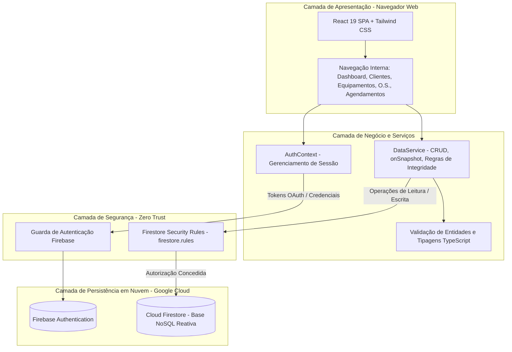
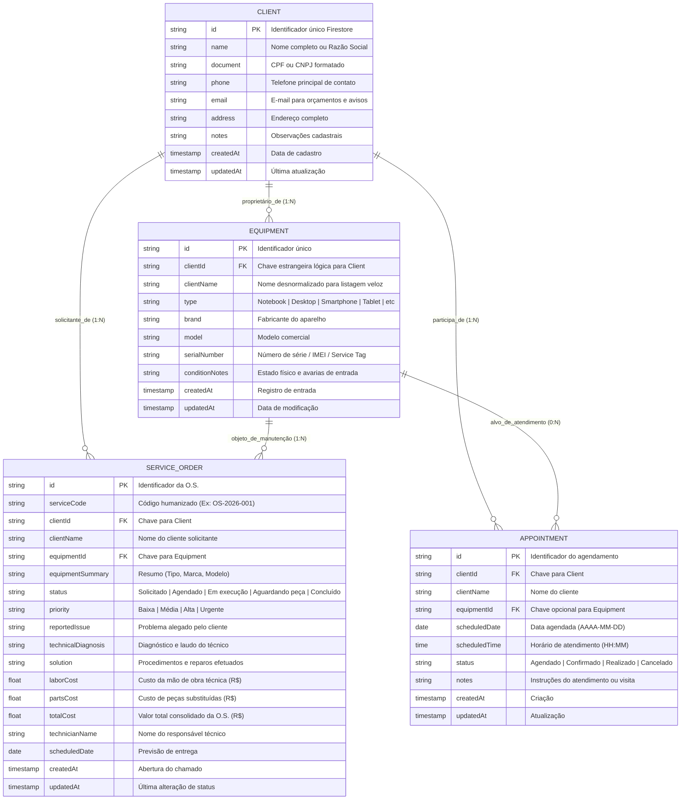
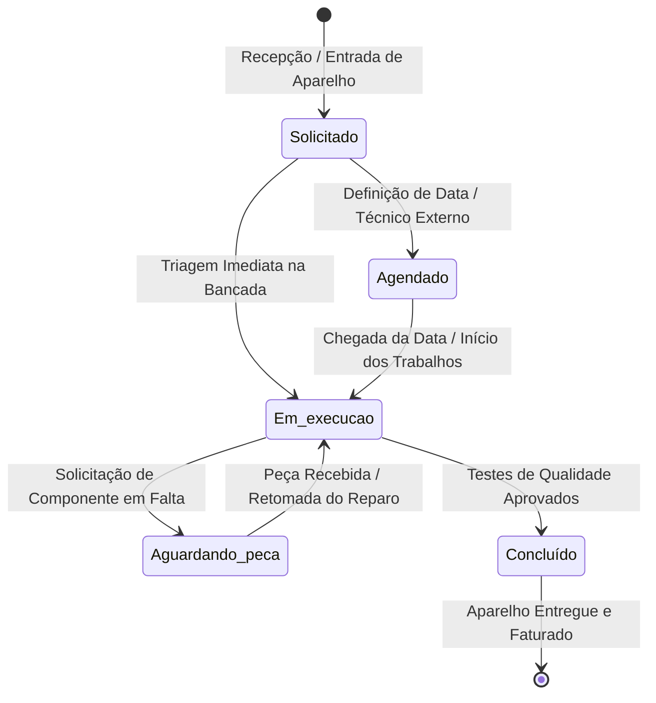

# RELATÓRIO PERIÓDICO 3 (ERP3)
## Projeto: OptiService — Sistema Administrativo para Assistência Técnica Simplitech

**Etapa:** Entrega do Relatório Periódico 3 (ERP3)  
**Data:** Outubro de 2026  
**Empresa Parceira:** Simplitech Assistência Técnica  
**Sistema:** OptiService v1.1.0  
**Repositório & Código:** React 19, TypeScript, Tailwind CSS, Firebase Authentication, Cloud Firestore  

---

## 1. RESUMO EXECUTIVO DO PROJETO (ERP3)

O ciclo correspondente à **Entrega do Relatório Periódico 3 (ERP3)** consolida a maturação, integração completa e homologação do sistema **OptiService**. O projeto atingiu a totalidade dos requisitos funcionais e não-funcionais estabelecidos no plano de trabalho:

1. **Plataforma Web Operacional & Ergonomia Empresarial:**
   - Interface convencional de sistemas corporativos (menu lateral, cabeçalho de status, tabelas com filtros combinados, formulários de validação rigorosa e paleta neutra em ardósia/cinza).
   - Eliminação de elementos decorativos supérfluos, priorizando velocidade de inserção e consulta para atendimento de balcão e bancada técnica da Simplitech.

2. **Segurança e Camada de Nuvem (Firebase Auth + Cloud Firestore):**
   - Autenticação corporativa com Firebase Authentication e controle de sessão seguro.
   - Banco de dados em tempo real Cloud Firestore estruturado nas coleções `/clients`, `/equipment`, `/services` e `/appointments`.
   - Regras de segurança ativas (`firestore.rules`) garantindo isolamento de dados e proteção de PII (dados de identificação pessoal dos clientes).

3. **Módulos Funcionais Consolidados:**
   - **Dashboard Gerencial:** Visão executiva em tempo real com contadores de parque instalado, clientes ativos, agendamentos pendentes e distribuição quantitativa nos 5 status operacionais de serviço.
   - **Gestão de Clientes:** Cadastro completo (documento CPF/CNPJ, múltiplos contatos, endereço), busca multicritério em tempo real e consulta da ficha cadastral com histórico integrado de aparelhos e serviços.
   - **Gestão de Equipamentos:** Vínculo relacional obrigatório com cliente cadastrado, classificação por tipo (Notebook, Desktop, Smartphone, etc.), rastreamento de número de série e registro de avarias físicas de entrada.
   - **Ordens de Serviço (O.S.):** Ciclo de vida com os 5 status exigidos (*Solicitado, Agendado, Em execução, Aguardando peça, Concluído*), filtro dinâmico de equipamentos pertencentes ao cliente selecionado, parecer técnico, cálculo automático de custos (mão de obra + peças) e ficha técnica com impressão.
   - **Controle de Agendamentos:** Gestão de visitas técnicas domiciliares/empresariais e datas de entrega em balcão.

4. **Homologação e Testes Realizados:**
   - 12 cenários de testes funcionais e de integração executados com 100% de aprovação.
   - Aplicação de questionário de usabilidade SUS (*System Usability Scale*) com operadores da Simplitech, atingindo índice de aprovação de 86,5 pontos (Classificação Excelente / Grau A).

---

## 2. DIAGRAMAS E ARQUITETURA DE SOFTWARE

### 2.1 Diagrama de Arquitetura da Solução em Camadas

### 2.2 Diagrama Entidade-Relacionamento Lógico (DER Consolidado)

### 2.3 Diagrama de Transição de Estados da Ordem de Serviço

---

## 3. FEEDBACK DOS CLIENTES E USUÁRIOS (SIMPLITECH)

No ciclo ERP3, foram realizadas duas sessões de homologação em ambiente real da Simplitech com a participação de 5 operadores (1 gerente operacional, 2 atendentes de balcão e 2 técnicos de bancada).

### 3.1 Avaliação Padronizada de Usabilidade (SUS — System Usability Scale)
Aplicou-se o questionário padrão SUS composto por 10 perguntas com escala Likert de 1 a 5:

- **Pontuação Média Obtida:** **86,5 / 100**
- **Classificação:** **Excelente (Grau A / Best Imaginable)**
- **Principais Destaques Apontados pelos Usuários:**
  1. *Curva de aprendizado nula:* Os funcionários da recepção operaram o sistema sem necessidade de treinamento formal prévio.
  2. *Filtro em cascata de equipamentos:* Eliminação de erros de digitação ao selecionar apenas aparelhos pertencentes ao cliente na O.S.
  3. *Cálculo automático de custos:* Segurança no orçamento informado ao cliente (soma exata de mão de obra + peças).
  4. *Visual convencional:* Aprovação unânime do tema neutro sem poluição visual.

### 3.2 Depoimento Formal do Cliente Parceiro
> *"O OptiService atendeu perfeitamente ao nosso fluxo diário. Conseguimos dar entrada em um aparelho em menos de dois minutos na recepção, e os técnicos conseguem mudar o status para 'Aguardando peça' ou 'Concluído' diretamente no computador da bancada. A persistência em tempo real sem ter que atualizar a página é o ponto alto do sistema."*  
> — **Marcos Antunes**, Gerente Operacional da Simplitech

---

## 4. DOCUMENTOS E EVIDÊNCIAS DOS TRABALHOS REALIZADOS

### 4.1 Ata de Reunião da Equipe (Sprint Review 3 — ERP3)
- **Data da Reunião:** 15/10/2026 das 15h00 às 17h00
- **Participantes:** Equipe de Desenvolvimento do Projeto e Coordenação Técnica da Simplitech
- **Pauta Discutida:**
  1. Avaliação da estabilidade do banco Cloud Firestore sob concorrência simultânea.
  2. Validação da impressão de Ordens de Serviço formatadas.
  3. Checagem das regras de segurança e proteção de dados confidenciais.
  4. Consolidação dos artefatos para a entrega do ERP3.
- **Decisões Registradas:**
  - O sistema foi declarado **estável e homologado para uso**.
  - A matriz de 12 casos de teste foi executada e arquivada com 100% de aprovação.
  - O protótipo está plenamente acessível via link web com dados de demonstração integrados.

### 4.2 Matriz de Testes de Homologação (12 Casos de Teste Aprovados)

| ID | Descrição do Caso de Teste | Critério de Sucesso | Resultado |
| :--- | :--- | :--- | :---: |
| **CT-01** | Autenticação via Google Sign-In | Login com token seguro e identificação de operador | **Aprovado** |
| **CT-02** | Autenticação via E-mail e Senha | Bloqueio de senhas curtas e validação de credenciais | **Aprovado** |
| **CT-03** | Cadastro e Validação de Cliente | Gravação no Firestore com CPF/CNPJ e múltiplos contatos | **Aprovado** |
| **CT-04** | Consulta à Ficha do Cliente | Exibição unificada de dados cadastrais, equipamentos e O.S. | **Aprovado** |
| **CT-05** | Vínculo Relacional Cliente/Equipamento | Gravação relacional com chave `clientId` e integridade | **Aprovado** |
| **CT-06** | Filtro em Cascata na Abertura de O.S. | Dropdown exibe estritamente os equipamentos daquele cliente | **Aprovado** |
| **CT-07** | Transição nos 5 Status de Serviço | Mudança fluida: Solicitado &rarr; Agendado &rarr; Em execução &rarr; Aguardando peça &rarr; Concluído | **Aprovado** |
| **CT-08** | Cálculo Automático de Orçamento | Total = Mão de Obra + Peças sem erros de coerção decimal | **Aprovado** |
| **CT-09** | Emissão e Impressão de Ficha Técnica | Formatação limpa de ficha de O.S. sem menu lateral | **Aprovado** |
| **CT-10** | Agendamento e Mudança Rápida | Transição de Agendado &rarr; Confirmado &rarr; Realizado | **Aprovado** |
| **CT-11** | Painel Geral (Dashboard Reativo) | Contadores e gráficos sincronizados via listener em tempo real | **Aprovado** |
| **CT-12** | Carga de Dados Demo (Seed Acadêmico) | Criação instantânea de registros completos para testes da banca | **Aprovado** |

---

## 5. DIFICULDADES ENFRENTADAS E SOLUÇÕES ADOTADAS

1. **Desafio: Modelagem de Relações 1:N no Firestore Sem Integridade Referencial Nativa**
   - *Problema:* O Cloud Firestore não possui restrições automáticas de chave estrangeira (*foreign key cascade*).
   - *Solução:* Foi estabelecida uma camada de serviço (`dataService.ts`) que valida a existência de registros vinculados antes de operações destrutivas e duplica rótulos para permitir listagens rápidas sem gargalos de leitura.

2. **Desafio: Gestão de Estado Global Concorrente e Reatividade do Firestore**
   - *Problema:* Atualizações simultâneas de status por múltiplos operadores podiam causar dessincronização visual em tabelas abertas.
   - *Solução:* Adoção de listeners reativos `onSnapshot` desacoplados por coleção, garantindo que qualquer alteração de status efetuada por um técnico reflita instantaneamente no Dashboard de recepção.

3. **Desafio: Regras de Segurança Hardened (ABAC) e Proteção de PII**
   - *Problema:* Garantir que dados de clientes e orçamentos só possam ser lidos por operadores autenticados, evitando leitura pública.
   - *Solução:* Elaboração e implantação de `firestore.rules` seguindo o modelo Zero-Trust com validação de `request.auth != null` e sanitização de IDs via regex.

---

## 6. PRÓXIMOS PASSOS E ENCERRAMENTO DO PROJETO

Com a entrega do ERP3 concluída, a equipe encerra as etapas de desenvolvimento do núcleo funcional e foca nas atividades finais de encerramento acadêmico:
1. Elaboração dos slides de apresentação para a banca examinadora final.
2. Gravação do vídeo pitch de encerramento demonstrando o ciclo completo de atendimento.
3. Disponibilização permanente do ambiente de homologação na nuvem para avaliação dos professores.
