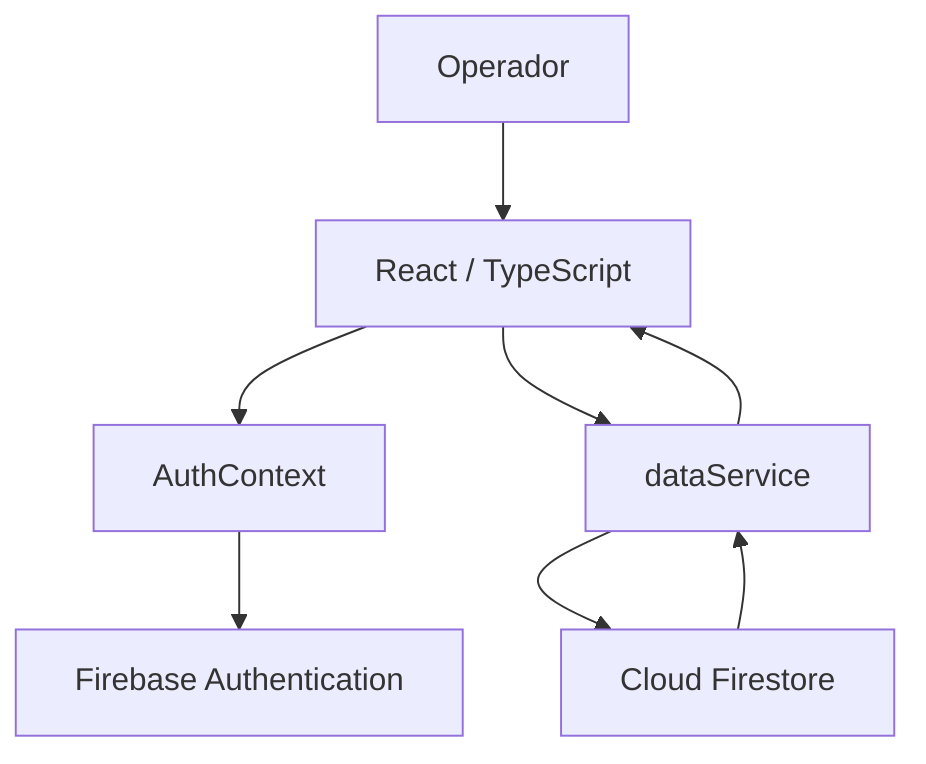
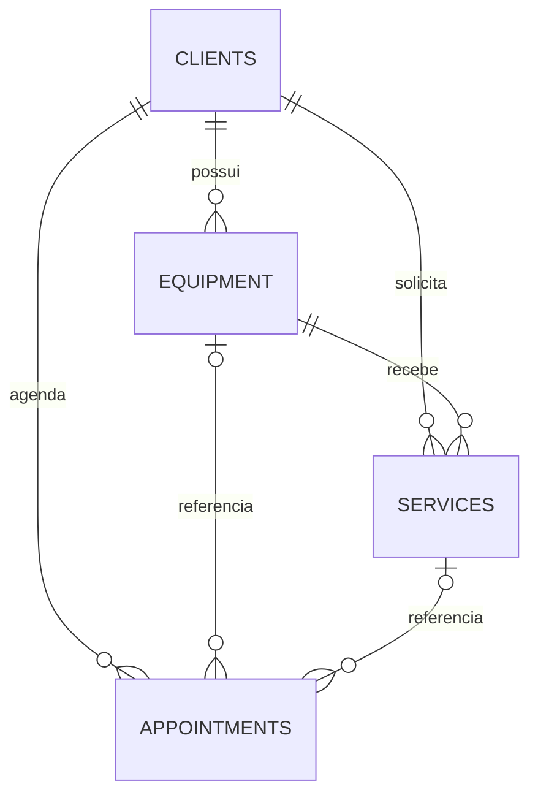
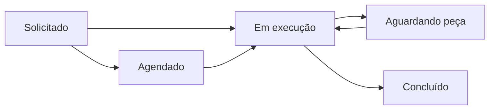

# OptiService — RP7

Produto: OptiService. Empresa parceira: Simplitech. Grupo: Optiflow.

## Problema e requisitos
Centralizar atendimento, equipamentos, agenda e ordens de serviço. RF01 autenticação; RF02 clientes; RF03 equipamentos vinculados; RF04 ordens de serviço; RF05 agenda; RF06 cinco status; RF07 histórico; RF08 dashboard; RF09 exportação CSV; RF10 impressão; RF11 indicadores financeiros. RNF: responsividade, mensagens claras, proteção dos dados, manutenção e rastreabilidade. Instalação PWA e operação offline não foram verificadas.

## Arquitetura

O frontend usa o SDK Firebase diretamente; não há servidor REST próprio implementado. `onSnapshot` atualiza as listas. As regras atuais exigem autenticação, mas não distinguem operadores autorizados de qualquer conta autenticada: usar somente dados fictícios até configurar autorização adequada.

Fluxo operacional esperado; o seletor permite mudanças diretas e não impõe esta sequência.

## Correções RP6
Código recuperado do ZIP original; preparação de CI/CD, monitoramento HTTP, bloqueio de exclusão com consulta ao servidor, proteção CSV contra fórmulas, idioma HTML e caminhos relativos de publicação. Removidos dados cadastrais fictícios da ficha. A checagem de vínculos não é atômica e não garante integridade sob concorrência.

## Validação MVP
Relatórios anteriores registram SUS 86,5/100 e testes manuais. O documento EVIDENCIAS_E_FEEDBACK.md contém registros históricos; confirmar autenticidade e anexar evidências originais. Não houve nova avaliação verificada nesta etapa.

## Testes RP7 a executar
Login; CRUD cliente/equipamento; abertura e mudança de status de O.S.; agenda; exclusão vinculada bloqueada; exportação com acentos e fórmulas; impressão; dashboard; build e deploy; disponibilidade HTTP. Registrar data, responsável, resultado e captura. Não declarar aprovação antes da execução.
